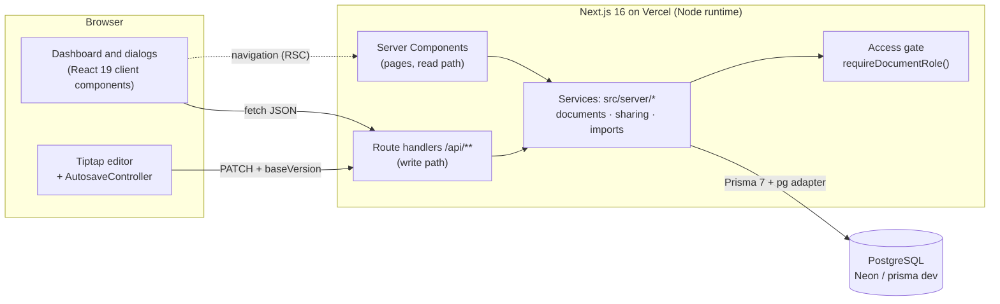
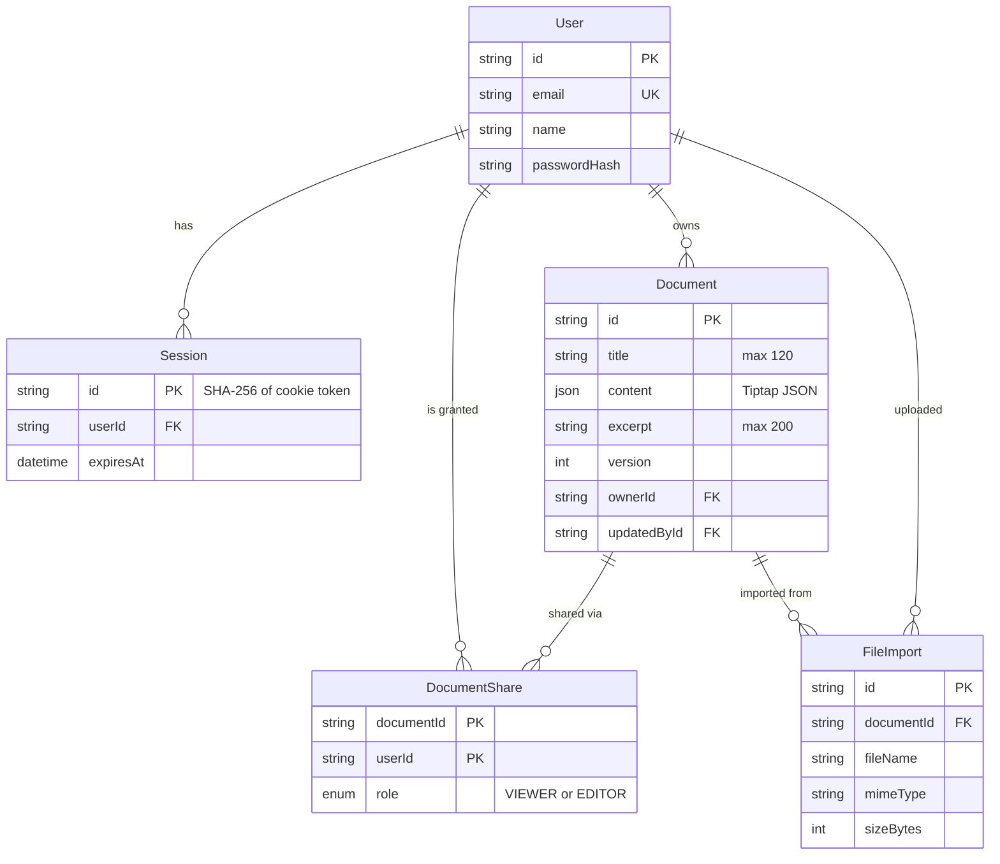
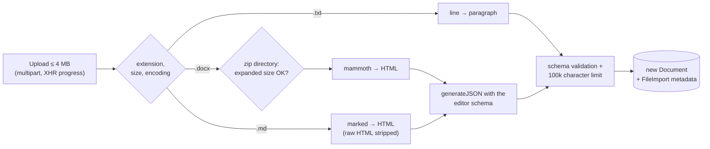
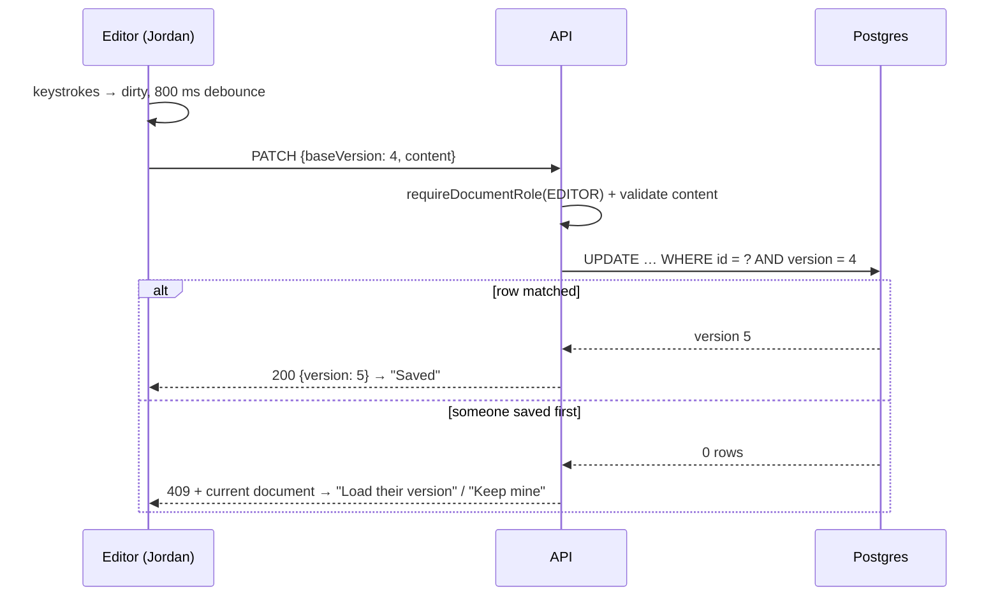

# Architecture

Papertrail is a single Next.js application. Pages, API routes, and business logic deploy together as one Vercel project, backed by one PostgreSQL database. This document explains how it fits together and why.

## What I prioritized

The brief asks for depth over breadth, so I invested in the three places where a document product actually fails in practice:

1. **Access control that can't be bypassed.** Every read and write goes through one server-side gate. The UI hides controls for convenience, but it never enforces access.
2. **Edits that are never silently lost.** Autosave is debounced, serialized, and retried, and two people saving the same document can't overwrite each other unnoticed.
3. **Content integrity.** Documents are stored as structured JSON and validated against the editor's own schema on the server, so a crafted request can't store content the editor can't render.

## System overview



- **Reads** go through Server Components, which call the service layer directly, so pages arrive rendered with no client-side fetch waterfall.
- **Writes** go through JSON route handlers, which call the same services. Authorization therefore exists exactly once, in the services, no matter which path a request takes.

## Frontend architecture

| Concern | Approach |
| --- | --- |
| Routing | App Router: `/login`, `/` (dashboard, `?view=mine\|shared`), `/documents/[id]`, each with its own `loading.tsx`, `error.tsx`, or `not-found.tsx` |
| Rendering | **Cache Components** are enabled. Static shells (sidebar, chrome) are prerendered; anything that reads the session cookie streams inside `<Suspense>`. |
| State | Server data comes in as props. Local UI state uses React state. The dashboard view lives in the URL (`history.pushState`), and search filters the loaded list in memory. |
| Editor | Tiptap 3 with a single extension list (`src/lib/editor/extensions.ts`) shared with the server validator and the importer |
| Components | shadcn/ui (Radix) primitives, Tailwind 4 design tokens in `src/app/globals.css`, Lucide icons. One light theme. |
| Auth changes | Sign-in and sign-out do a full page navigation, so no cached data from the previous user can survive in the client router |

**Design system.** The visual direction is *pine ink on warm paper*. Warm neutral surfaces carry one accent (pine), used only for primary actions, focus, and "can edit". Type is Geist for the interface and the Newsreader serif for headings and the document itself. Motion is limited to 150–220 ms and disabled under `prefers-reduced-motion`. On phones the sidebar becomes a drawer and the Share dialog becomes a bottom sheet.

## Backend architecture

```
src/app/api/**/route.ts     thin handlers: parse input (Zod) → call a service → JSON
src/lib/http.ts             publicRoute / authedRoute wrappers: session lookup, Origin check, error mapping
src/server/access.ts        the single authorization gate
src/server/documents.ts     list, get, create, update (version-checked), delete
src/server/sharing.ts       collaborators, share by email, change role, revoke
src/server/imports.ts       file → HTML → editor JSON conversion, with size and zip-bomb guards
src/server/seed.ts          idempotent demo data (used by `prisma db seed` and the tests)
```

**Errors.** Services throw a typed `AppError(status, code, message)`. One wrapper turns it into `{ error: { code, message, details? } }` with the right status code. Zod errors become `400`, and anything unexpected is logged server-side and returned as a generic `500`. Next.js control-flow errors (redirect, not-found, prerender bail-outs) are re-thrown first so they're never swallowed. The client shows the server's message as is, for example "Documents are limited to 100,000 characters."

## API structure

| Method | Route | Minimum role | Purpose |
| --- | --- | --- | --- |
| `POST` | `/api/auth/login` | none | Email + password; sets the session cookie |
| `POST` | `/api/auth/logout` | none | Deletes the session row and clears the cookie |
| `GET` | `/api/documents` | signed in | Documents you own or have been shared, each with your role |
| `POST` | `/api/documents` | signed in | Create a document |
| `GET` | `/api/documents/:id` | viewer | Read a document |
| `PATCH` | `/api/documents/:id` | editor | Save title and/or content; body must include `baseVersion` |
| `DELETE` | `/api/documents/:id` | owner | Delete the document; shares and import records cascade |
| `GET` | `/api/documents/:id/shares` | viewer | Owner and collaborators, plus `canManage` |
| `POST` | `/api/documents/:id/shares` | owner | Share by email as `VIEWER` or `EDITOR` (changes the role if already shared) |
| `PATCH` / `DELETE` | `/api/documents/:id/shares/:userId` | owner | Change role / revoke access |
| `POST` | `/api/imports` | signed in | Multipart upload; creates a new document from `.docx`, `.md`, or `.txt` |
| `GET` | `/api/users` | signed in | Other accounts, for share suggestions |

Status codes are consistent across routes: `400` validation · `401` not signed in · `403` role too low · `404` missing **or** no access · `409` stale version · `413` too large · `415` unsupported file type.

## Database design



- **One owner per document**, stored on `Document.ownerId` rather than as a share row. A document always has exactly one owner, who can't be "un-shared".
- `excerpt` is kept up to date on every save, so the dashboard never loads full document bodies.
- The migration adds `CHECK` constraints (non-blank title, version ≥ 1, content is a JSON `doc` object, non-negative file size) as a second line of defense under application validation.
- Persistence is an external Postgres database. The app writes nothing to the server's filesystem, which suits serverless hosting.

## Document data model

Content is stored as **ProseMirror/Tiptap JSON**, not HTML:

- It's lossless and structured, with no HTML-sanitization surface.
- On every write the server rebuilds the editor schema and runs `Node.fromJSON(schema, json).check()`, which rejects unknown node or mark types and invalid nesting. It also checks attribute values the schema doesn't constrain (heading level 1–3, ordered-list start). Limits are 100,000 characters and 2 MB of JSON.
- The supported set is deliberately small (paragraph, H1–H3, bold, italic, underline, bulleted and numbered lists) and complete. Links, code, images, and tables are disabled rather than half-supported.

## Authentication

Sharing only means something if the server knows who is asking, so I used real sessions instead of a mocked user header:

- **Passwords:** hashed with scrypt (`node:crypto`). Unknown emails are checked against a dummy hash, so response time and error message don't reveal which accounts exist.
- **Sessions:** a 32-byte random token goes in the cookie, and only its **SHA-256** is stored, so a database leak can't be replayed as a login. The cookie is `HttpOnly`, `SameSite=Lax`, `Secure` in production, and lasts 7 days. Sign-out deletes the row.
- **Identity** always comes from the session. No endpoint accepts a user ID that grants the caller anything.

## Sharing and permission model

Roles are ordered **VIEWER < EDITOR < OWNER**. Every service call goes through one function:

```ts
requireDocumentRole(documentId, user, minimumRole) // src/server/access.ts
```

| Action | Viewer | Editor | Owner |
| --- | :-: | :-: | :-: |
| Open, read, see collaborators | ✅ | ✅ | ✅ |
| Edit content, rename | | ✅ | ✅ |
| Share, change roles, revoke, delete | | | ✅ |

- **No access returns `404`, not `403`**, so document IDs can't be probed to find out what exists. The page shows the same *You can't open this document* state for missing and forbidden documents.
- The role is looked up on **every request**, so revoking or downgrading access takes effect immediately, even for an editor who already has the document open. Their next save gets `403`/`404`, autosave stops, and the page re-renders as read-only or not-found.

## File upload and storage architecture



- Imports always **create a new document** owned by the uploader. That's the most product-relevant flow ("bring my existing doc in"), and it avoids merge questions.
- Conversion runs on the server and always ends in the **same schema validation** as normal saves, so anything unsupported is dropped rather than stored. Images are counted and the user is told how many were skipped.
- **Decompression-bomb guard:** XML compresses about 300:1. QA measured a 105 KB `.docx` costing about 10 s of CPU and 1.5 GB of RAM inside mammoth. The server now reads the zip's central directory first and rejects any XML part over 10 MB, or more than 40 MB in total, before inflating anything.
- **Originals are not stored**, only their metadata in `FileImport`. That means no blob storage, which would be a paid service or extra setup for reviewers.
- The 4 MB limit stays under Vercel's 4.5 MB request-body limit, so users see our error message rather than a platform error.

## Autosave implementation

`AutosaveController` (`src/components/editor/use-autosave.ts`) is a small class rather than a web of effects, so its state machine can be read top to bottom.



- **One request in flight at a time**, each carrying the version returned by the previous one, so a user's own saves can't conflict or arrive out of order. Edits made during a save are sent next.
- **Failures are handled by type:**
  - Network or 5xx errors retry with backoff (up to 30 s) and show *Offline · retrying in Ns*.
  - `401` keeps the edits, offers **Sign in** in a new tab, and retries when the tab regains focus.
  - `403`/`404` means access changed: autosave stops and the page re-renders.
  - `409` pauses saving until the user chooses a version.
- Opening a document never creates a save. A `beforeunload` guard warns about unsaved edits, including a save still in flight, and pending edits are flushed on in-app navigation.

## Security considerations

| Threat | Mitigation |
| --- | --- |
| Accessing another user's document (IDOR) | One access gate in the service layer; no access → `404`. Tested by changing IDs in URLs and API calls. |
| Role escalation | Owner-only share routes; roles never come from the client. Tested: viewers and editors can't promote themselves. |
| XSS | Content is stored as schema-validated JSON and rendered by ProseMirror and React (text, never HTML). Markdown raw HTML is stripped. Link marks are disabled, so `javascript:` URLs can't be stored. No `dangerouslySetInnerHTML`. |
| CSRF | `SameSite=Lax` cookies and an `Origin` check on every mutating request |
| Session theft | `HttpOnly` + `Secure` cookies; only token hashes are stored; sessions expire after 7 days |
| Malicious uploads | Extension allowlist, size limits, UTF-8 and zip-signature checks, the zip-bomb guard, and server-side schema validation of the result |
| Clickjacking, sniffing | `X-Frame-Options: DENY`, `frame-ancestors 'none'`, `nosniff`, strict referrer policy; `X-Powered-By` disabled |
| SQL injection | Prisma's parameterized queries only; no raw SQL |
| Secrets | None in the repository. `.env` is git-ignored; `.env.example` holds only local placeholders. |

**Accepted for a demo:** no sign-in rate limiting (it needs shared state such as Redis to be meaningful on serverless). `/api/users` lists the demo accounts to any signed-in user, which powers share suggestions.

## Engineering tradeoffs

| Decision | Alternative | Why |
| --- | --- | --- |
| Version-checked saves | Real-time CRDT (Yjs) | Guarantees no silent overwrites at a fraction of the cost, and fits serverless functions without a websocket server |
| JSON content + schema validation | Store HTML and sanitize it | Lossless, smaller attack surface, and the same schema works in the browser, on the server, and in imports |
| Convert imports, don't store files | Blob storage (S3/Vercel Blob) | No paid dependency for reviewers; the product value is an editable document |
| Monolith with a service layer | Separate API service | One deploy, shared types end to end; the service layer keeps it easy to split later |
| Integration tests against real Postgres | Unit tests with mocks | Most bugs in this kind of app sit at the seams (auth × validation × SQL), which mocks would hide |
| Seeded accounts with real sessions | OAuth / identity provider | Shows a real authorization model without an external setup step for reviewers |
| Client-side dashboard search | Postgres full-text search | Instant at demo scale; full-text search is the next step once lists are paginated |

**Why this architecture fits the assessment:** it covers the full stack (UI, API, authorization, persistence, file processing) with production-grade guarantees where they matter. It deploys for free with one click, and reviewers need nothing beyond a database to run it.

## Testing strategy

- **22 Vitest integration tests** call the real route handlers with real `Request` objects against a real Postgres, reset between tests. They cover auth, permissions (including no existence leaks and immediate revocation), stale-save conflicts, content-schema validation, and every import rejection path, including zip bombs.
- **`npm run audit:api`** is a black-box audit with about 108 checks over HTTP as three users. It can be pointed at a deployment.
- **Static checks:** strict TypeScript, ESLint with React Compiler rules, and a production `next build`.
- **Manual and automated browser passes:** fault injection in a real browser (offline, expired session, in-flight saves, two-user conflicts, mid-session revocation and downgrade, long documents) during the QA phase. There is no committed end-to-end suite yet (see below).

## Future improvements

1. **Playwright end-to-end tests** for the two-user sharing, conflict, and autosave flows, turning the manual browser checks into a repeatable suite.
2. **Version history:** snapshot content every N saves into a `DocumentVersion` table, with restore. The version column already exists.
3. **Real-time collaboration:** presence first (a heartbeat endpoint), then Yjs over a websocket provider for live co-editing.
4. **Sign-in rate limiting** (Upstash/Vercel KV) and a health check endpoint.
5. Comments, links and images (with blob storage), export to PDF and Markdown, and server-side search with pagination.
