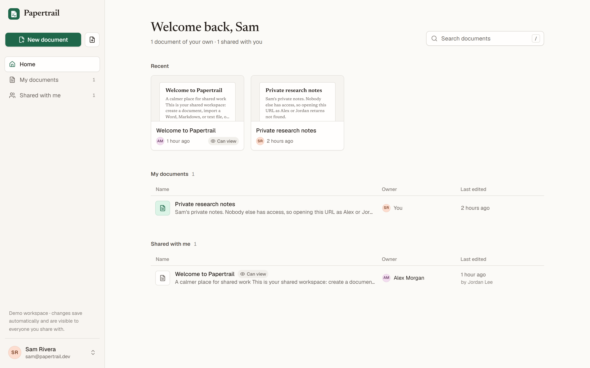

# Papertrail

**A lightweight collaborative document editor**, built for the Ajaia AI-Native Full Stack Developer assessment.

Users sign in, write and format documents in a real rich-text editor, import Word, Markdown, or text files, and share documents with teammates as **viewers** or **editors**. Everything persists in PostgreSQL, and access is enforced on the server for every request.



| | |
| --- | --- |
| **Live demo** | [papertail-wea4.vercel.app](https://papertail-wea4.vercel.app) (password `papertrail-demo` for every demo account) |
| **Walkthrough video** | [Loom](https://www.loom.com/share/803399d5b5cd49568b211fad03b38eb9) |
| **Architecture and tradeoffs** | [ARCHITECTURE.md](./ARCHITECTURE.md) |
| **How AI was used** | [AI_WORKFLOW.md](./AI_WORKFLOW.md) |
| **What's in the submission** | [SUBMISSION.md](./SUBMISSION.md) |
| **Screenshots** | [screenshots/](./screenshots) |

---

## Features

| Area | What works |
| --- | --- |
| **Documents** | Create, rename (inline title or dashboard menu), edit, reopen, and delete (owner only, with confirmation). The dashboard has *Recent*, *My documents*, and *Shared with me*, plus instant search over title, text, and owner. |
| **Rich text** | Normal text, Heading 1–3, bold, italic, underline, bulleted and numbered lists, and undo/redo, using the toolbar, keyboard shortcuts (Ctrl/⌘+B/I/U), or Markdown shortcuts (`# `, `- `, `1. `). |
| **Autosave** | Saves about 0.8 s after you stop typing (Ctrl/⌘+S saves immediately), with a live status: *Saved*, *Saving…*, *Offline · retrying*, *Not saved*. Failed saves retry automatically, and leaving with unsaved changes asks you to confirm. |
| **Conflict safety** | Every save names the version it was based on. If someone else saved first, nothing is overwritten: you choose **Load their version** or **Keep mine**. |
| **File import** | `.docx`, `.md`/`.markdown`, and `.txt` files up to 4 MB each become a new editable document, keeping headings, lists, and bold/italic/underline. Unsupported or broken files get a specific error. |
| **Sharing** | The owner shares by email as *Can view* or *Can edit*, and can change or remove access (with Undo). Viewers get a read-only editor. Changes apply on the next request, even to a document that is already open. |
| **Auth** | Email and password sign-in for seeded demo accounts, with server-side sessions in an `HttpOnly` cookie. |
| **Responsive** | On a phone, the sidebar becomes a drawer, the editor goes full width, and dialogs open as bottom sheets. |

## Demo accounts

All accounts use the password **`papertrail-demo`**. The sign-in page also has one-click buttons for each account.

| User | Email | Seeded access |
| --- | --- | --- |
| Alex Morgan | `alex@papertrail.dev` | Owns *Welcome to Papertrail* (Jordan can edit, Sam can view); can **view** *Design review notes* |
| Jordan Lee | `jordan@papertrail.dev` | Owns *Design review notes*; can **edit** *Welcome to Papertrail* |
| Sam Rivera | `sam@papertrail.dev` | Owns *Private research notes* (not shared); can **view** *Welcome to Papertrail* |

**Two-minute tour:**
1. Sign in as **Alex**. Open *Welcome to Papertrail*, format some text, and watch the status change to *Saved*. Reload the page: the formatting is still there.
2. Click **Share**, add `sam@papertrail.dev` as *Can view*, then click **Copy link**.
3. Use the account menu to **Switch demo account** to **Sam**, and open the link. The document is read-only.
4. As Alex, open `/documents/research-notes` (Sam's private document). You get *You can't open this document*.
5. Click **Import a file** and pick one of the files in [`samples/`](./samples).

## Tech stack

| Layer | Choice |
| --- | --- |
| Framework | Next.js 16 (App Router, React 19, Cache Components), TypeScript (strict) |
| UI | Tailwind CSS 4, shadcn/ui (Radix primitives), Lucide icons, Sonner toasts |
| Editor | Tiptap 3 (ProseMirror) |
| Data | PostgreSQL with Prisma 7 (`@prisma/adapter-pg`) |
| Validation | Zod 4, plus ProseMirror schema validation of document content |
| Imports | mammoth (`.docx`), marked (`.md`), `@tiptap/html` with happy-dom (HTML to editor JSON) |
| Tests | Vitest 5 integration tests and a black-box API audit script |
| Hosting target | Vercel with Neon Postgres (free tiers) |

## Run locally

### Prerequisites
- **Node.js 22.12+ or 24+** (Prisma 7 and Vitest 5 require it; developed on Node 26) and npm 10+.
- No Docker or cloud account is needed. Prisma's built-in local Postgres (`prisma dev`) is used. Any PostgreSQL 14+ also works.

### 1. Install
```bash
npm install            # also runs `prisma generate`
```

### 2. Start local databases
```bash
npm run db:dev         # local Postgres for the app  (instance "papertrail")
npm run db:test        # separate Postgres for tests (instance "papertrail-test"); optional if you won't run tests
npx prisma dev ls      # lists both instances and their TCP connection URLs
```

### 3. Configure environment
Copy `.env.example` to `.env` and check that the URLs match the **TCP** URLs from `npx prisma dev ls`. The defaults in `.env.example` are the ports `prisma dev` usually assigns.

| Variable | Required | Purpose |
| --- | --- | --- |
| `DATABASE_URL` | yes | App database connection string |
| `TEST_DATABASE_URL` | for `npm test` | A **separate** database for the test suite. ⚠️ It is wiped before every test, so never point it at data you care about. |
| `SHADOW_DATABASE_URL` | only for `prisma migrate dev` | Shadow database used when you change the schema |
| `DATABASE_POOL_MAX` | local only | Set to `1` for `prisma dev`, which serves one connection at a time. Leave it unset elsewhere (default 5). |
| `DATABASE_URL_UNPOOLED` | production | Direct (non-pooled) URL used by migrations and the seed. Injected by the Vercel Neon integration. |

There are no API keys or other secrets: the app only needs a database.

### 4. Migrate and seed
```bash
npm run db:migrate     # apply migrations (prisma migrate deploy)
npm run db:seed        # create demo users and documents; safe to re-run, never overwrites edits
```

### 5. Run
```bash
npm run dev            # development server at http://localhost:3000
# or a production build:
npm run build && npm start
```

To stop the local databases, run `npx prisma dev stop papertrail` and `npx prisma dev stop papertrail-test`.

## Scripts

| Command | What it does |
| --- | --- |
| `npm run dev` | Development server |
| `npm run build` / `npm start` | Production build / serve it |
| `npm run lint` | ESLint (Next.js + React Compiler rules) |
| `npm run typecheck` | `tsc --noEmit` (strict) |
| `npm test` | Integration tests (Vitest) against `TEST_DATABASE_URL` |
| `npm run audit:api [-- <url>]` | Black-box API audit (about 108 checks) against a running server (default `http://localhost:3000`). Run it after seeding. It cleans up everything it creates. |
| `npm run db:dev` / `npm run db:test` | Start local Postgres instances (`prisma dev`) |
| `npm run db:migrate` / `npm run db:seed` | Apply migrations / seed demo data |
| `npm run vercel-build` | Vercel build: generate client, migrate, seed, `next build` |

## Testing

```bash
npm run db:test   # once; make sure TEST_DATABASE_URL in .env points at it
npm test
```

**22 integration tests** (`tests/*.test.ts`) call the real route handlers with real `Request` objects against a real Postgres. Nothing is mocked except Next's `server-only` marker. They cover:

| File | Coverage |
| --- | --- |
| `auth.test.ts` | Cookie flags, identical errors for wrong password and unknown email, sign-out and expiry, hashed session tokens, cross-site request blocking |
| `documents.test.ts` | Rich-text round trip, stale saves rejected with `409`, title and content-schema validation (including invalid attributes), owner-only delete with cascade, list roles |
| `permissions.test.ts` | Not found without access, viewer read-only, editors can't manage sharing, revocation applies on the next request, share validation |
| `imports.test.ts` | Markdown, `.docx`, and text conversion; every rejection path; `.docx` decompression bombs |

`npm run audit:api` exercises the running app over HTTP as all three users. It covers cross-account access with tampered IDs, role escalation, revocation, HTML and script payloads in titles, text, and files, malicious and corrupt uploads, and concurrent saves.

## Supported import formats

| Format | Notes |
| --- | --- |
| `.docx` (Word 2007+) | Headings (including Title/Subtitle), bulleted and numbered lists, bold, italic, and underline are kept. Images are skipped (you are told how many). Tables become plain paragraphs. |
| `.md`, `.markdown` | Headings, lists, bold, italic. Raw HTML is removed except `<u>` and `<br>`. |
| `.txt` | UTF-8 only; each line becomes a paragraph. |

Limit: 4 MB per file, which stays under Vercel's 4.5 MB request limit. Legacy `.doc`, empty, corrupt, non-UTF-8, and oversized files (including a `.docx` that expands past a safe size when unzipped) are rejected with specific messages. Imports always create a **new** document; the original file is not stored.

## Deploying (Vercel + Neon)

1. Push the repository to GitHub and import it in Vercel. The Next.js preset is detected automatically.
2. In the project, open **Storage → Neon** and connect it to all environments. This injects `DATABASE_URL` and `DATABASE_URL_UNPOOLED`.
3. Set **Build Command** to `npm run vercel-build`. It runs migrations and seeds the demo accounts. The seed only adds missing rows, so redeploys never overwrite user edits.
4. Deploy, then optionally verify the deployment with `npm run audit:api -- https://<your-app>.vercel.app`.

## Project structure

```
src/
  app/                 routes: /login, / (dashboard), /documents/[id], /api/**
  components/          dashboard, editor (toolbar, autosave), sharing dialog, shadcn/ui primitives
  lib/                 auth (password, session), HTTP helpers, validation, editor schema, API client
  server/              services and business rules: documents, sharing, access gate, imports, seed data
prisma/                schema, SQL migration (with CHECK constraints), seed entry point
tests/                 Vitest integration tests and helpers
scripts/               api-audit.mjs: black-box HTTP audit
samples/               example .docx / .md / .txt files for trying imports
screenshots/           screenshots of the running app
```

## Known limitations

- **No real-time co-editing or presence.** Simultaneous edits are detected and resolved by the user (*Load their version* / *Keep mine*), not merged live.
- **Demo authentication only:** seeded accounts, with no sign-up, password reset, or rate limiting on sign-in. `/api/users` lists the demo accounts so the share dialog can suggest them.
- **No images, tables, links, comments, version history, or export** in documents.
- **Imports create new documents only.** There is no import into an existing document, and original files are not kept.
- Dashboard search runs in the browser over the loaded list; there is no pagination.
- The no-access page streams with HTTP status 200 (Next.js partial prerendering), although it shows no document data.

## Notes

- `package.json` pins `prosemirror-schema-list` and `prosemirror-inputrules` to 1.6.0 through `overrides`, because newer patch tarballs returned 404 from the npm registry during development.
- `AGENTS.md` is generated by Next.js 16 for AI coding agents and is kept unchanged.
